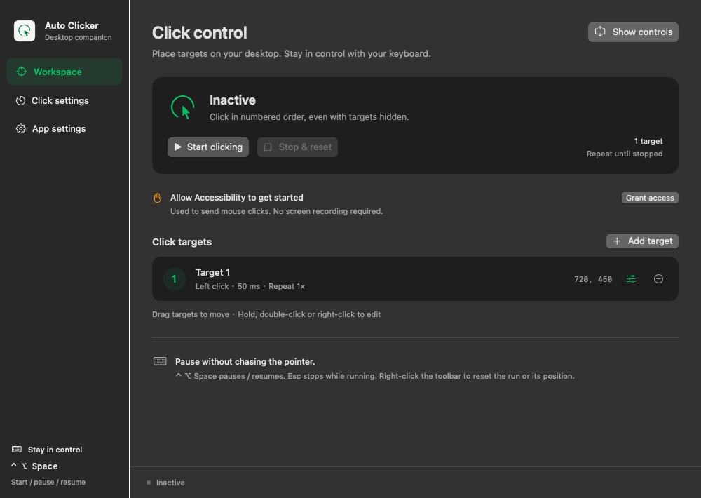
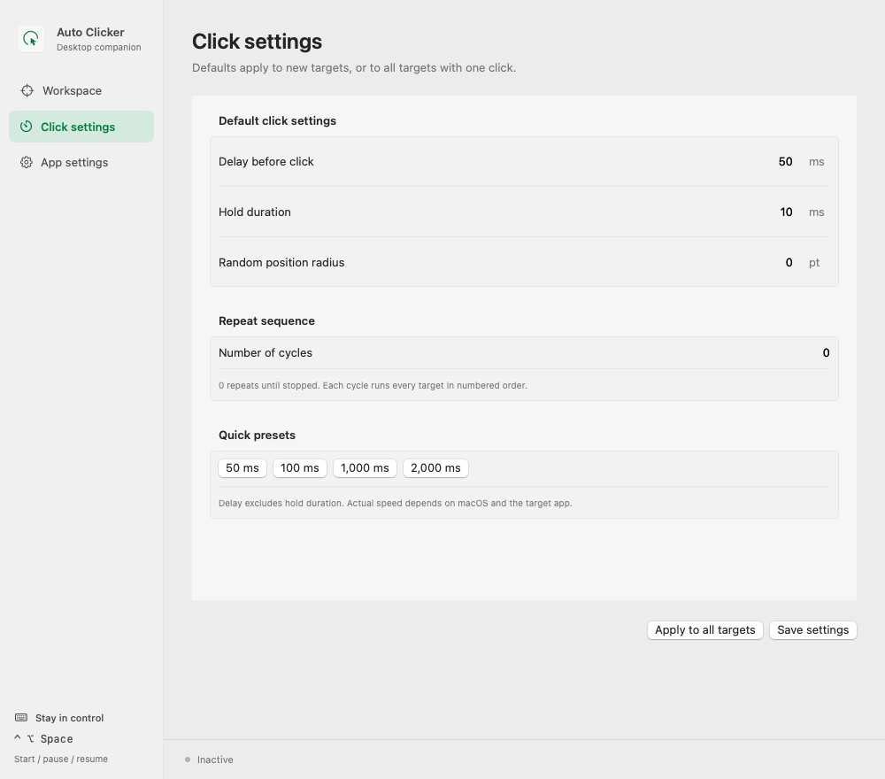
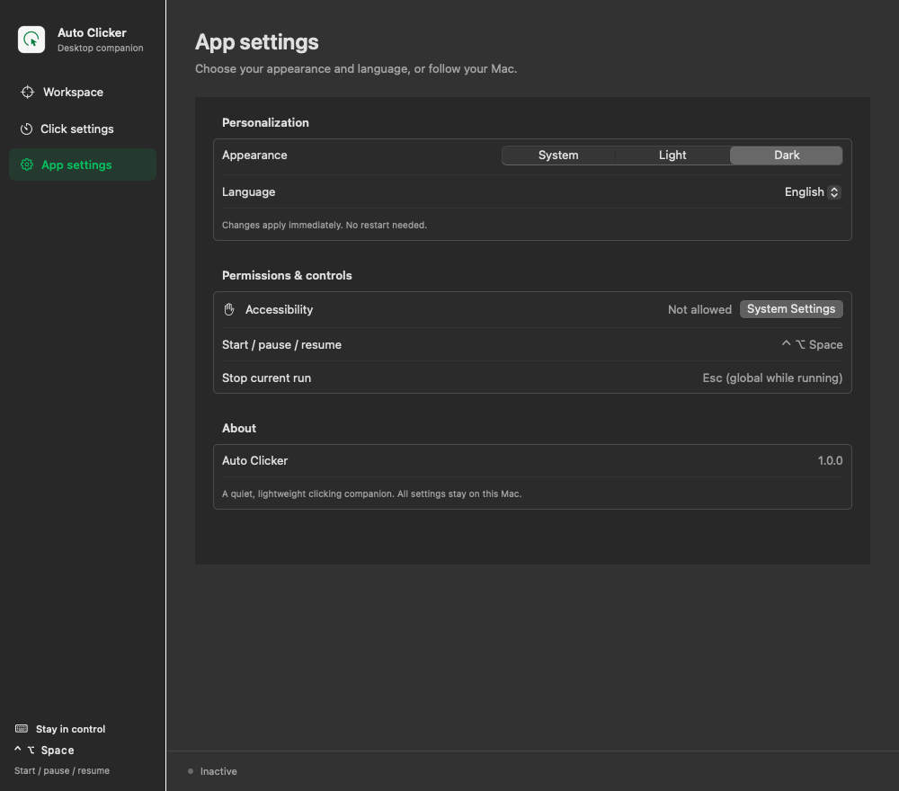

# Auto Clicker

**English** | [简体中文](README.zh-CN.md)

Automate repeated clicks on your Mac. Place numbered targets on the screen,
set the timing for each one, and start or pause from a floating toolbar.
Supports macOS 13 or later on Apple Silicon and Intel Macs.

[Download](https://github.com/oyjt/auto-clicker/releases) · [Changelog](CHANGELOG.md) · [Report an issue](https://github.com/oyjt/auto-clicker/issues)



*Interface previews; window decorations and materials may differ on your Mac.*

## Features

- **One target or a sequence:** add up to 50 targets and run them in numbered order.
- **Adjust each click:** left, right or double-click, delay, hold duration, repeats,
  random position and random delay.
- **Stay in control:** start, pause and resume with a global shortcut; keep completed
  progress when pausing, or stop and reset when finished.
- **Fit your desktop:** multiple displays, movable floating controls, and light or
  dark appearance.
- **Keep it local:** no account, network connection or telemetry. Settings stay on your Mac.

## Install

1. Download `AutoClicker-X.Y.Z-universal.dmg` from
   [Releases](https://github.com/oyjt/auto-clicker/releases).
2. Open the DMG, drag the app into **Applications**, then eject the DMG and open the
   installed app. The bundle's filename is `自动点击器.app`.
3. Allow **Auto Clicker** in **System Settings → Privacy & Security → Accessibility**.
   Screen Recording permission is not required.

The app is not yet notarized by Apple, so macOS may block the first launch.
If you trust the download, follow [Apple's instructions for opening the app](https://support.apple.com/en-us/102445).

## Get started

1. Select **Show controls** in the workspace.
2. Drag the numbered target to where you want to click. Hold it for 0.55 seconds,
   double-click or right-click to edit its settings.
3. Use `+` to add targets, then select **Start** on the toolbar.
4. Select **Pause** to keep your progress, then **Resume** to continue.
   Choose **Stop & reset** from the toolbar's right-click menu to finish.


*From left: drag handle, pause/resume, add target, remove target, hide/show targets,
settings, close controls.*

Drag the six-dot handle to move the toolbar; its position is remembered. Moving it
or opening settings pauses an active run. Hiding target markers keeps clicking;
closing the controls stops and resets the session.

### Keyboard shortcuts

| Shortcut | Action |
| --- | --- |
| Control + Option + Space | Start, pause or resume globally |
| Escape | Stop and reset while running, when the global key is available |
| Command + , | Open settings |

Use the keyboard to pause if automated mouse movement makes the toolbar hard to reach.

## Customize clicks

Set defaults in **Click settings**, then apply them to new targets or all targets.
Edit an individual target when it needs a different click type, timing or repeat
count. A cycle runs every target in order; set the cycle count to `0` to keep going
until stopped. Delay is measured before each click and excludes hold duration;
actual speed depends on macOS and the target app.



## Appearance and language

In **App settings**, choose **System**, **Light** or **Dark**, and **System default**,
**English** or **简体中文**. Changes take effect immediately. Both preferences follow
your system by default.

<details>
<summary>View app settings</summary>



</details>

## Common questions

**The app opens, but it does not click.** Check its Accessibility permission.
If you moved or replaced the app, remove its old entry from the Accessibility list
and add the copy in Applications again.

**What happens to a paused run?** Completed progress is kept. An interrupted click
is retried in full on resume. Changing target positions or click settings resets
the paused plan; changing appearance, language or marker visibility does not.

**What if my Mac sleeps or a display disconnects?** Clicking stops on sleep,
display-layout changes or loss of Accessibility permission. Clicks inside the
floating toolbar are skipped to keep its controls accessible.

**How do I update?** Download the newer DMG from Releases, quit the app, and replace
the copy in Applications. There is no in-app updater.

<details>
<summary>Verify a download</summary>

Download the matching `.sha256` file beside the DMG, then run in that folder:

```sh
shasum -a 256 -c AutoClicker-X.Y.Z-universal.dmg.sha256
```

</details>

For source builds and contributions, see the [development guide](docs/DEVELOPING.md).
Maintainers can follow the [release guide](docs/RELEASING.md).
