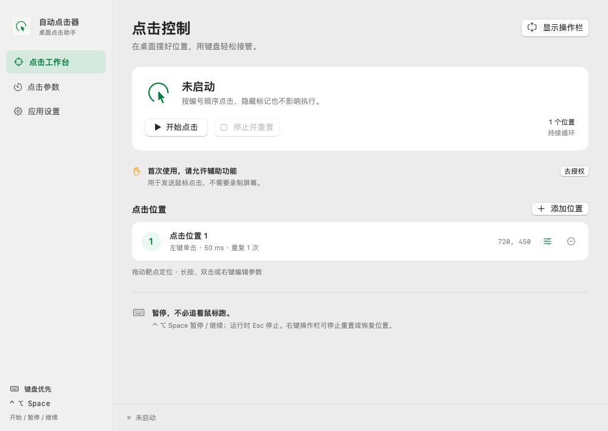
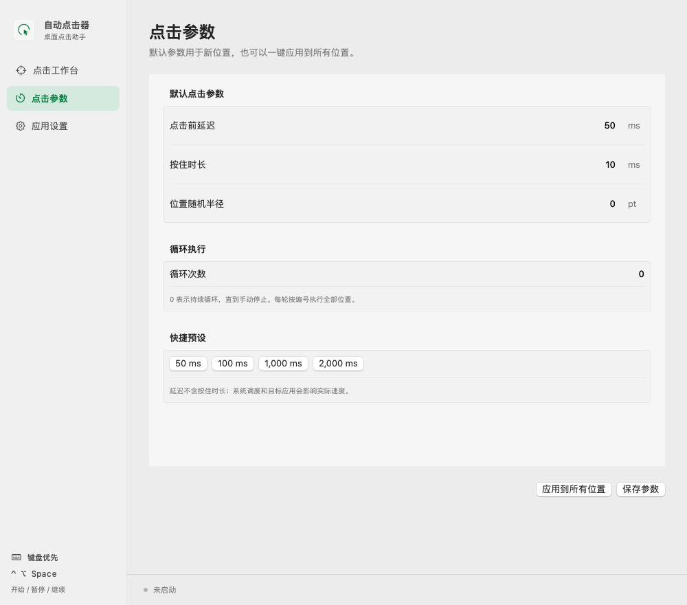
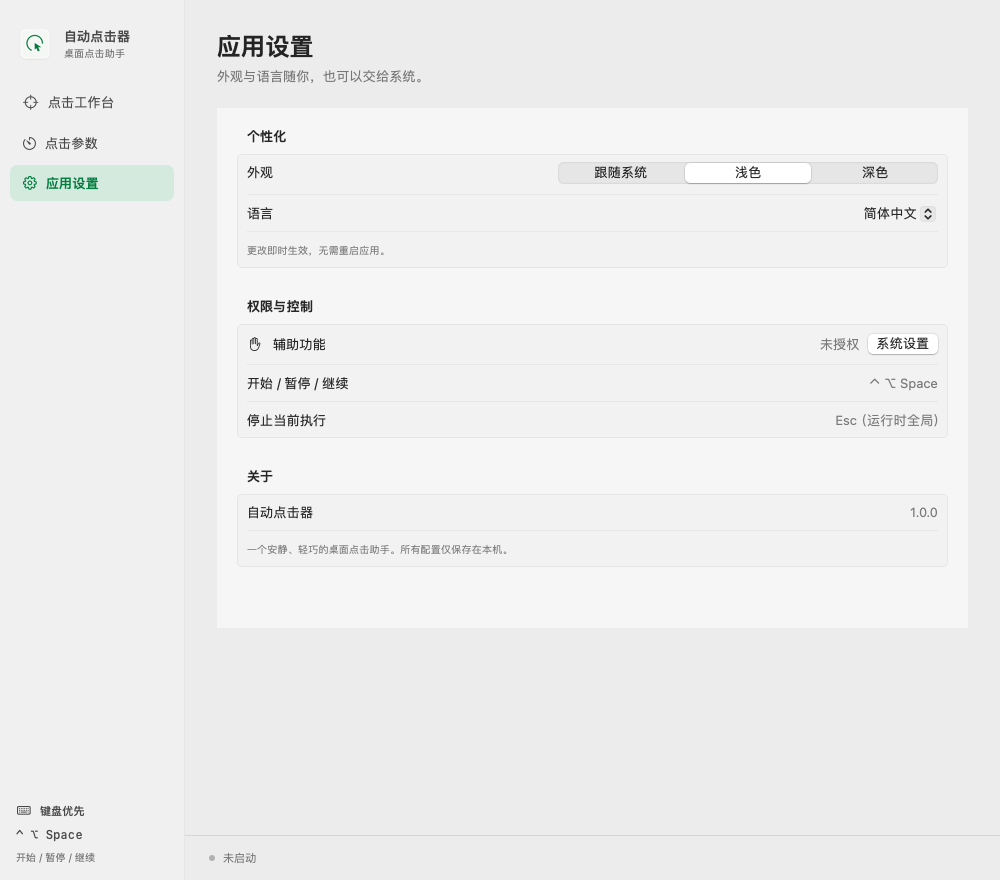

# 自动点击器 · Auto Clicker

[English](README.md) | **简体中文**

在 Mac 上自动重复点击。把编号靶点拖到需要的位置，为每个位置设置点击方式和间隔，再通过悬浮操作栏开始或暂停。支持 macOS 13 及以上版本，兼容 Apple Silicon 和 Intel Mac。

[下载安装包](https://github.com/oyjt/auto-clicker/releases) · [更新日志](CHANGELOG.md) · [反馈问题](https://github.com/oyjt/auto-clicker/issues)



*图片为界面预览，实际窗口边框和材质可能因系统环境而不同。*

## 主要功能

- **单点或多点点击：**最多添加 50 个位置，按编号依次执行。
- **每个位置单独设置：**支持左键、右键、双击、点击前延迟、按住时长、重复次数、随机位置和随机延迟。
- **随时暂停和继续：**支持全局快捷键；暂停保留已完成进度，停止时可清空重来。
- **适应桌面布局：**支持多显示器、可拖动的悬浮操作栏，以及浅色和深色外观。
- **数据留在本机：**无需账号、无需联网、无遥测，设置保存在你的 Mac 上。

## 安装

1. 从 [Releases](https://github.com/oyjt/auto-clicker/releases) 下载 `AutoClicker-X.Y.Z-universal.dmg`。
2. 打开 DMG，将“自动点击器”拖入 **Applications（应用程序）**，推出磁盘映像后打开已安装的应用。
3. 在“系统设置 → 隐私与安全性 → 辅助功能”中允许“自动点击器”。**不需要录屏权限。**

应用尚未经过 Apple 公证，首次打开可能被 macOS 拦截。确认信任下载来源后，可按 [Apple 官方说明](https://support.apple.com/en-us/102445)允许打开。

## 开始使用

1. 在工作台点击“显示操作栏”。
2. 把编号靶点拖到需要点击的位置。长按 0.55 秒、双击或右键可编辑参数。
3. 用 `+` 添加更多位置，再点击操作栏的开始按钮。
4. 点击暂停可保留进度，继续后接着执行。结束时，右键操作栏选择“停止并重置”。


*从左到右：拖动抓手、暂停/继续、添加位置、删除位置、隐藏/显示标记、设置、关闭。*

拖动左侧六点抓手可移动操作栏，应用会记住位置。运行时拖动操作栏或打开设置会先暂停；隐藏标记不会停止点击，关闭操作栏则会停止并重置。

### 快捷键

| 快捷键 | 操作 |
| --- | --- |
| Control + Option + Space | 全局开始、暂停或继续 |
| Escape | 运行时停止并重置，需该全局按键可用 |
| Command + , | 打开设置 |

自动点击时鼠标会不断移动，建议用快捷键暂停。

## 调整点击参数

在“点击参数”中设置默认值，可用于新位置，也可一键应用到全部位置。某个位置需要不同的点击方式、间隔或重复次数时，再单独编辑该靶点。

所有位置按编号执行一遍算一轮；循环次数设为 `0`，会持续执行，直到你停止。点击前延迟不包含按住时长，实际速度取决于 macOS 和目标应用。



## 外观与语言

在“应用设置”中选择跟随系统、浅色或深色外观，以及跟随系统、简体中文或 English。修改后即时生效，两项默认都跟随系统。

<details>
<summary>查看应用设置页面</summary>



</details>

## 常见问题

**应用打开了，但没有点击？** 检查辅助功能权限。如果移动或替换过应用，请移除权限列表中的旧记录，再添加“应用程序”里的新副本。

**暂停后会从哪里继续？** 已完成进度会保留，被打断的一次点击会完整重试。修改位置或点击参数会重置暂停中的任务；切换外观、语言或标记显隐不会重置。

**休眠或拔掉显示器会怎样？** 休眠、显示器布局改变或辅助功能权限被撤销时会停止点击。操作栏区域内的点击会被跳过，避免误触控制按钮。

**如何更新？** 从 Releases 下载新版 DMG，退出应用后替换“应用程序”中的旧版本。目前不支持应用内自动更新。

<details>
<summary>校验下载文件</summary>

将对应的 `.sha256` 文件与 DMG 放在同一个文件夹，在该目录运行：

```sh
shasum -a 256 -c AutoClicker-X.Y.Z-universal.dmg.sha256
```

</details>

需要从源码构建或参与开发，请查看[开发指南（英文）](docs/DEVELOPING.md)；维护者请查看[发版指南（英文）](docs/RELEASING.md)。
